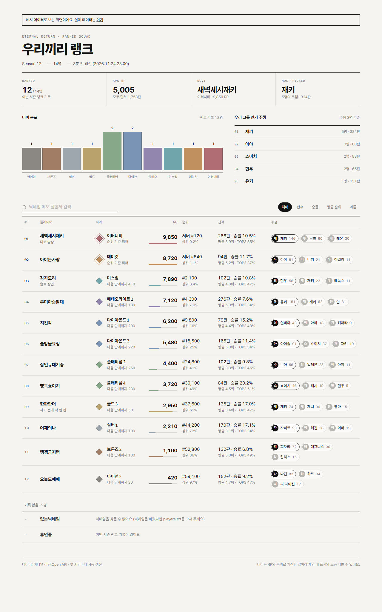

# 우리끼리 랭크 · 이터널 리턴

친구들의 이터널 리턴 **랭크 티어, RP, 주챔**을 한 페이지에서 보는 사이트예요.
GitHub가 3시간마다 공식 Open API에서 데이터를 가져와 자동으로 갱신해요. 서버와 비용은 필요 없어요.



## 파일 구성

| 파일 | 역할 |
| --- | --- |
| `players.txt` | 볼 사람들의 닉네임 목록 (한 줄에 한 명) |
| `index.html` | 사이트 화면 |
| `scripts/fetch_data.py` | API에서 정보를 모아 `data/players.json`으로 저장 |
| `.github/workflows/update.yml` | 3시간마다 자동 갱신 + 사이트 배포 |
| `data/sample.json` | 예시 데이터 (주소 뒤에 `?sample`을 붙이면 보여요) |

## 처음 설정하기 (한 번만)

1. **GitHub 저장소 만들기**
   GitHub에서 새 저장소를 **Public**으로 만들고, 이 폴더의 파일을 전부 올려요.
   무료 GitHub Pages는 공개 저장소에서만 돼요.

2. **닉네임 적기**
   `players.txt`를 열어 예시 줄을 지우고 닉네임을 한 줄에 하나씩 적어요.
   `닉네임, 메모` 형식으로 쓰면 메모가 닉네임 아래에 작게 나와요.

3. **API 키 등록** (키를 받은 뒤에)
   저장소 **Settings → Secrets and variables → Actions → New repository secret**
   - Name: `ER_API_KEY`
   - Secret: 발급받은 키

   키는 여기에만 넣어 주세요. 파일이나 채팅에 붙여넣으면 안 돼요.

4. **GitHub Pages 켜기**
   **Settings → Pages → Build and deployment → Source**를 **GitHub Actions**로 바꿔요.

5. **첫 실행**
   **Actions** 탭 → **랭크 데이터 갱신** → **Run workflow**.
   1~2분 뒤 `https://<GitHub 아이디>.github.io/<저장소 이름>/`에서 확인할 수 있어요.

> 키가 아직 없어도 1, 2, 4, 5단계를 하면 사이트는 열려요. "아직 데이터가 없어요" 화면과 예시 화면 링크가 보이고, Actions 실행 결과는 키를 등록하기 전까지 빨간색(실패)으로 표시돼요.

## 바꾸고 싶을 때

| 하고 싶은 것 | 방법 |
| --- | --- |
| 사람 추가/삭제 | `players.txt` 수정 후 커밋하면 자동으로 다시 갱신돼요 |
| 사이트 제목 | `index.html`의 `SITE_TITLE` |
| 갱신 주기 | `.github/workflows/update.yml`의 `cron` (UTC 기준, 기본 3시간마다) |
| 티어 RP 구간 | `scripts/fetch_data.py` 위쪽의 `TIERS` (시즌마다 바뀔 수 있어요) |
| 시즌 직접 지정 | Settings → Secrets and variables → Actions → **Variables** 탭에 `ER_SEASON_ID` 추가 |

## 내 컴퓨터에서 돌려보기

프로젝트 폴더에 `.env` 파일을 만들고 `ER_API_KEY=발급받은키`를 한 줄 적은 뒤 실행해요. `.env`는 `.gitignore`에 들어 있어서 GitHub에 올라가지 않아요.

```powershell
python scripts/fetch_data.py
```

```powershell
python -m http.server
```

그다음 http://localhost:8000 을 열면 돼요. `index.html`을 더블클릭해서 바로 열면 데이터를 못 불러와요.

## 알아둘 점

- **티어는 계산값이에요.** RP를 구간표에 맞춰 계산해요. 데미갓과 이터니티는 서버 순위(1000위·300위) 기준이라 게임 표시와 조금 다를 수 있어요.
- **닉네임을 바꾸면** 조회가 안 돼요. 화면 아래 "기록 없음"에 표시되니 `players.txt`를 고쳐 주세요.
- **일시적으로 조회에 실패한 사람**은 지난 데이터를 그대로 두고 "지난 데이터" 표시를 붙여요.
- **호출 제한:** 요청 사이에 1.1초씩 쉬어요. 30명 기준으로 한 번 갱신하는 데 1~2분, 약 60~70회 호출해요.
- GitHub는 저장소에 **60일간 활동이 없으면** 예약 실행을 멈출 수 있어요. 갱신이 멈추면 Actions 탭에서 다시 켜 주세요.
- API 주소와 응답 형식은 공식 문서 대신 커뮤니티 클라이언트 코드로 확인했어요. 첫 실행 로그에서 시즌 이름과 캐릭터 수가 제대로 나오는지 한 번 봐 주세요.

데이터 출처: 이터널 리턴 Open API (Nimble Neuron)
